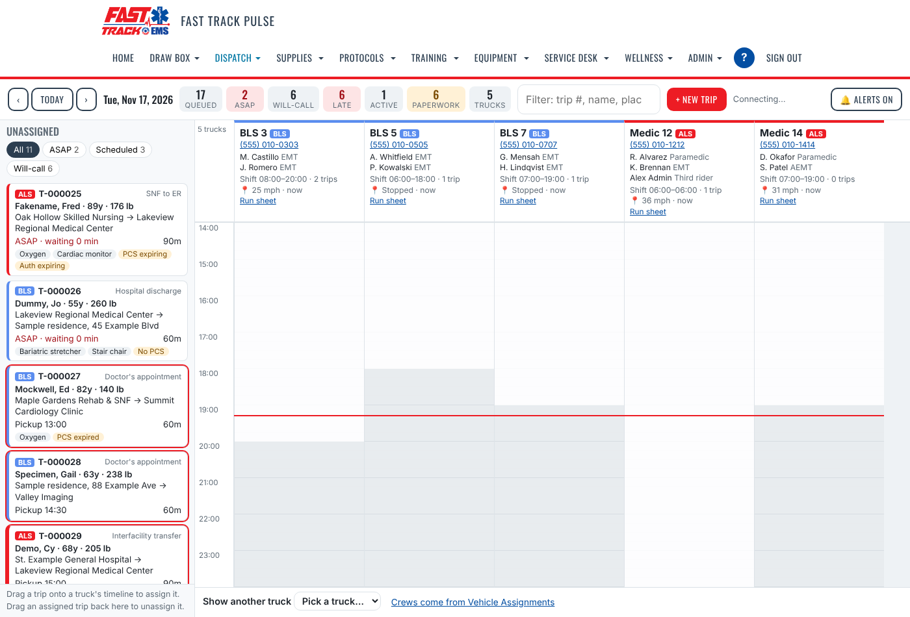
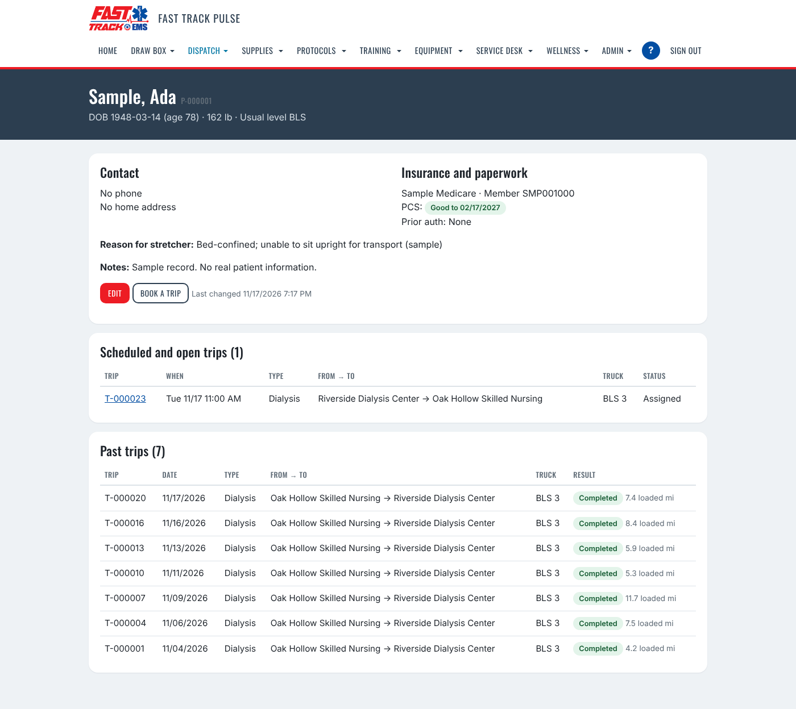
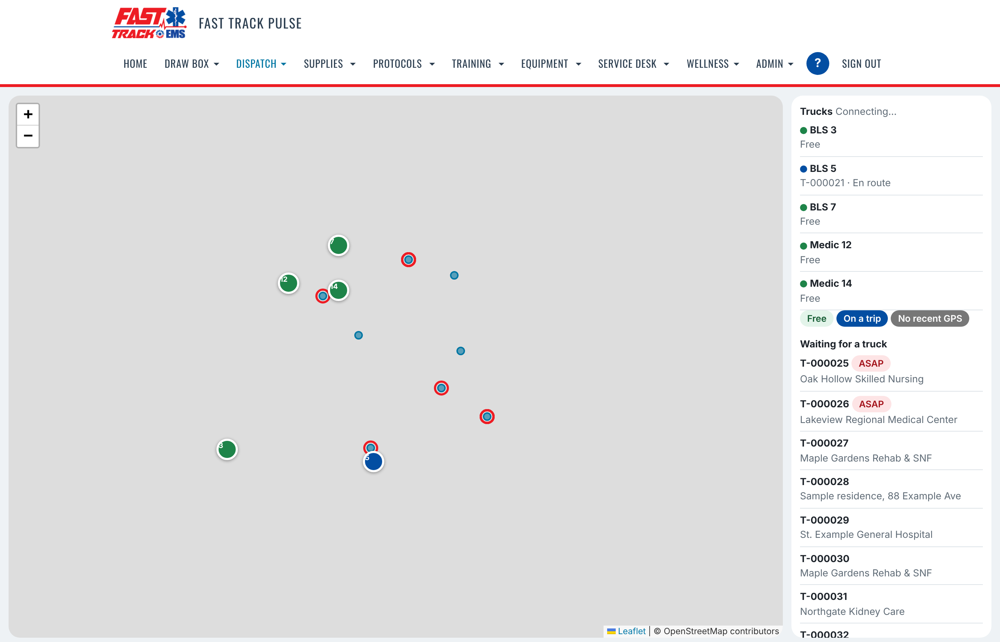
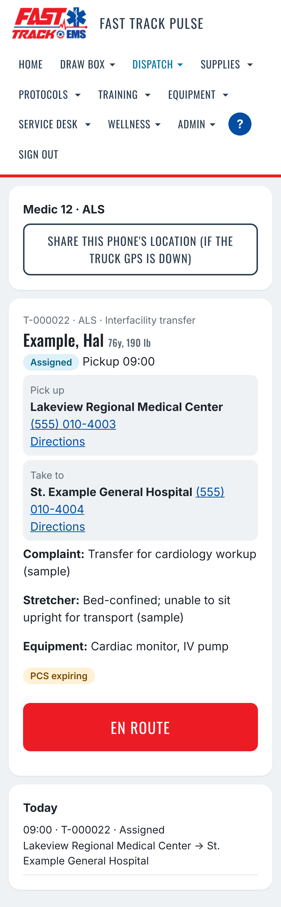
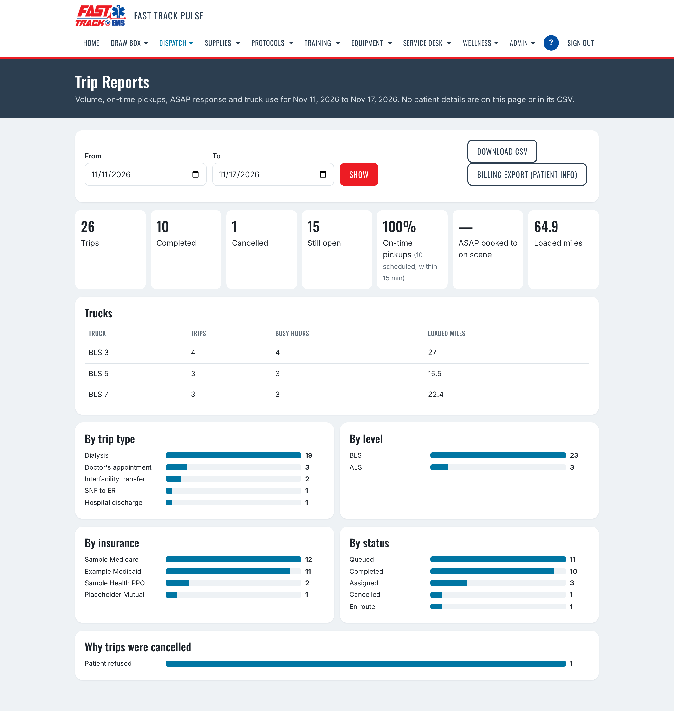
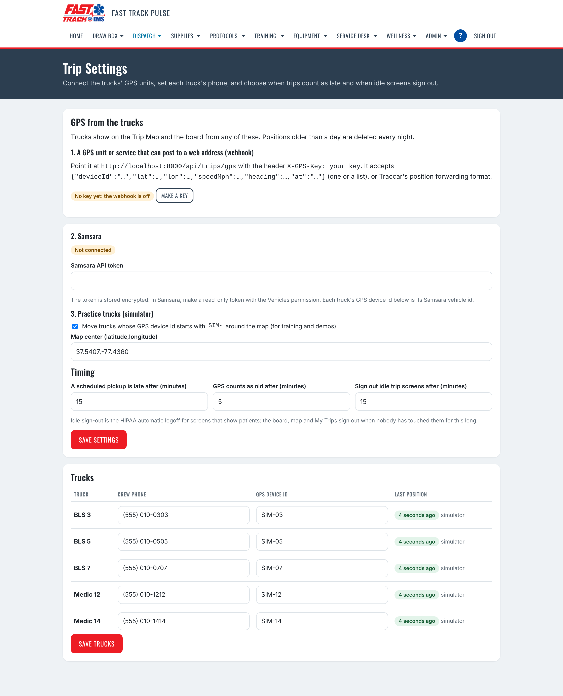
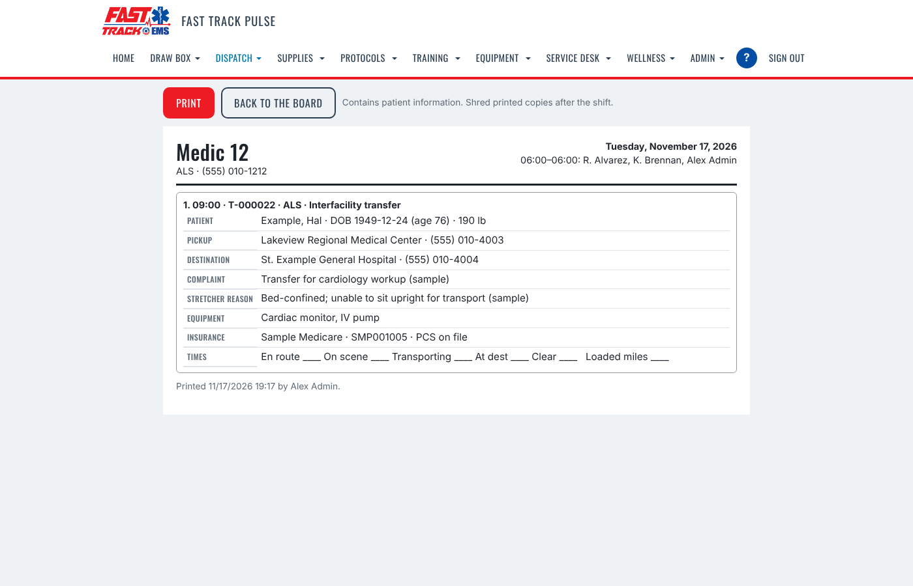
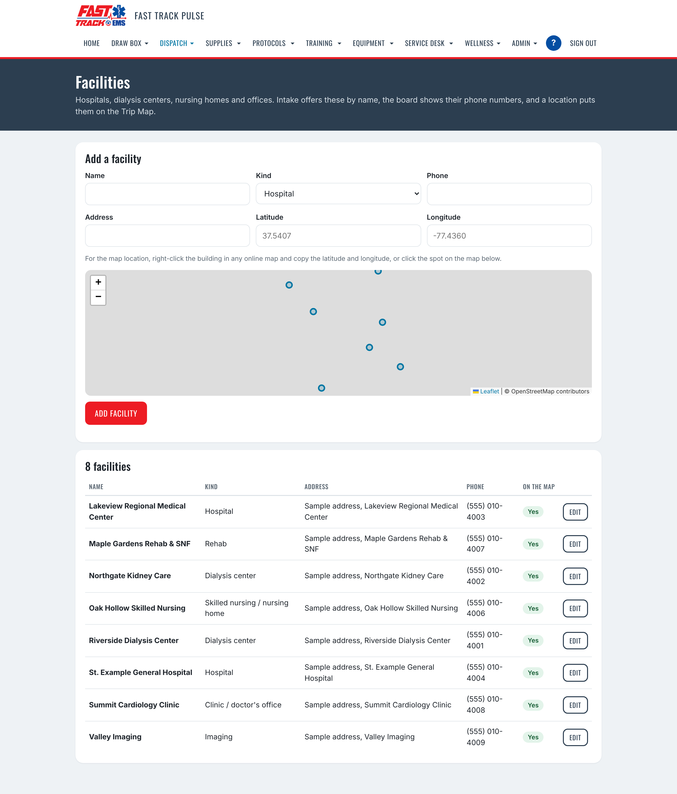

# Dispatch for Fast Track Pulse

This folder is the dispatch app rebuilt as a module of Fast Track Pulse (the `drawbox` Laravel app). It is
a Dispatch > Trip Board section that uses Pulse's sign-in, permission profiles, audit log, Vehicle
Assignments crews and look. It needs no Node.js and no build step, the same as the rest of Pulse.

The React/Node version in the rest of this repository is unchanged and still runs on its own.

Nothing here has been pushed to the drawbox repository. To add it to Pulse, apply the patch or copy the files
(below) on a branch of drawbox.

## What's here

- `trips-module.patch`: one commit made with `git format-patch` on top of drawbox `e0d69aa` (Admin > ID Cards, #122).
- `files/`: the same files laid out at their drawbox paths, for reading or copying by hand.

To try it on reactsolutions.com (pulse.reactsolutions.com), see [TRY-ON-REACTSOLUTIONS.md](TRY-ON-REACTSOLUTIONS.md).

## Add it to Pulse

From a drawbox checkout:

```bash
git checkout -b trips-module
git am /path/to/reactsolutions-dispatch/pulse/trips-module.patch
php artisan migrate
php artisan test          # 461 tests, including the 17 in tests/Feature/TripsTest.php
```

If drawbox has moved on and `git am` stops on a conflict, the conflicts will be in the shared files listed below.
Run `git am --abort` and copy the files from `files/` instead, merging those shared files by hand.

On the cPanel server, deploy the way Pulse already deploys, then:

```bash
php artisan migrate --force
php artisan config:cache && php artisan route:cache && php artisan view:cache
```

The cron job that runs `schedule:run` already covers the two new scheduled jobs, `trips:samsara` and `trips:prune-gps`.

Then, in Admin > Permission Profiles, give out the five new Dispatch permissions. The migration gives them to Admin only.

| Permission | Give it to |
| --- | --- |
| See the trip board | Anyone who should watch the board. They see patient initials only. |
| Dispatch trips | Dispatchers |
| My Trips | Crews (Team Members) |
| Trip reports | Supervisors and managers |
| Trip supervisor | Supervisors. This covers reopening closed trips, the billing export and Trip Settings. |

Practice data: `php artisan trips:sample you@fasttrackems.com` adds made-up facilities, trucks, crews,
patients and trips, and turns on the GPS simulator. On a production install, add `--force`.

## Files it adds and changes

New:
- `app/Trips/`
- `app/Http/Middleware/TripsIdle.php`
- `routes/trips.php`
- `resources/views/trips/`
- `public/js/trips-board.js`
- the migration `2026_11_18_000100_create_trip_tables.php`
- `tests/Feature/TripsTest.php`

Shared Pulse files, each changed by a few lines:
- `bootstrap/app.php`: routes and the `trips.idle` alias
- `app/Models/PermissionProfile.php`: the Dispatch permissions
- `app/Models/Setting.php`: defaults
- `app/Models/AuditLog.php`: action labels
- `app/Http/Middleware/AuditActions.php`: skips phone location pings
- `config/services.php`: map tiles and Samsara
- `resources/views/layouts/app.blade.php`: the Dispatch menu
- `routes/console.php`: commands and schedule
- `public/css/app.css`: a section at the end
- `README.md`: a Trip Board section

## Same features as the React version

| React app | In Pulse |
| --- | --- |
| Live board for several dispatchers (WebSocket) | Trip Board, which checks for changes every 4 seconds. cPanel can't keep a WebSocket server running. |
| Queue, 15-minute timeline, drag to assign, level/shift/overlap checks, version conflicts | Same |
| Intake: round trips, standing orders, patient lookup | Same |
| Patients with past and scheduled trips | Dispatch > Patients |
| GPS from third-party units | Webhook (generic JSON or Traccar), Samsara, crew phone, simulator |
| Closest-unit suggestions | Trip drawer, "Closest trucks" |
| Crew mobile screen | Dispatch > My Trips |
| Reports and CSV, billing export with loaded miles | Dispatch > Trip Reports |
| PCS and prior-auth expiry alerts | Trip cards, patient record, board metric |
| Run sheets | Run sheet link on each truck column |
| Sound alerts | Board, with a mute button |
| User management and roster editing | Pulse's Team Members, Permission Profiles and Vehicle Assignments |
| Facility address book with map | Dispatch > Facilities and Trip Map |

## Patient information

The data is sample data, but the module protects it as if it were real PHI:

- **Encryption at rest.** Names, dates of birth, member ids, complaints, notes and addresses are encrypted with Pulse's `APP_KEY`.
- **Searches.** They are POSTed, so names never show up in URLs or server logs.
- **Audit log.** It records who opened which trip or patient, and every billing export and run sheet. It identifies them by number only.
- **Viewers.** People who can only view the board see initials, and "Residence" in place of a home address.
- **Automatic sign-out.** Trip pages sign out after the idle minutes set in Trip Settings.
- **Notifications.** Desktop notifications leave out patient names.
- **CSV exports.** They guard against spreadsheet formula injection.

## Screenshots (sample data)

| | |
| --- | --- |
|  |  |
|  |  |
|  |  |
|  |  |

The map tiles are blank in these pictures only because the machine that took them had no internet access.
